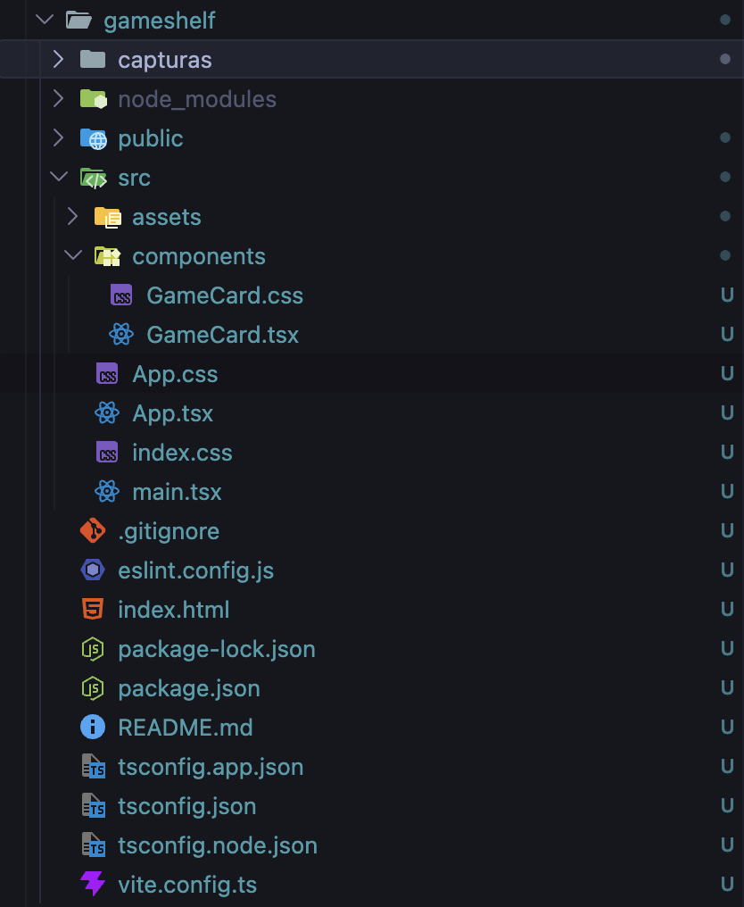
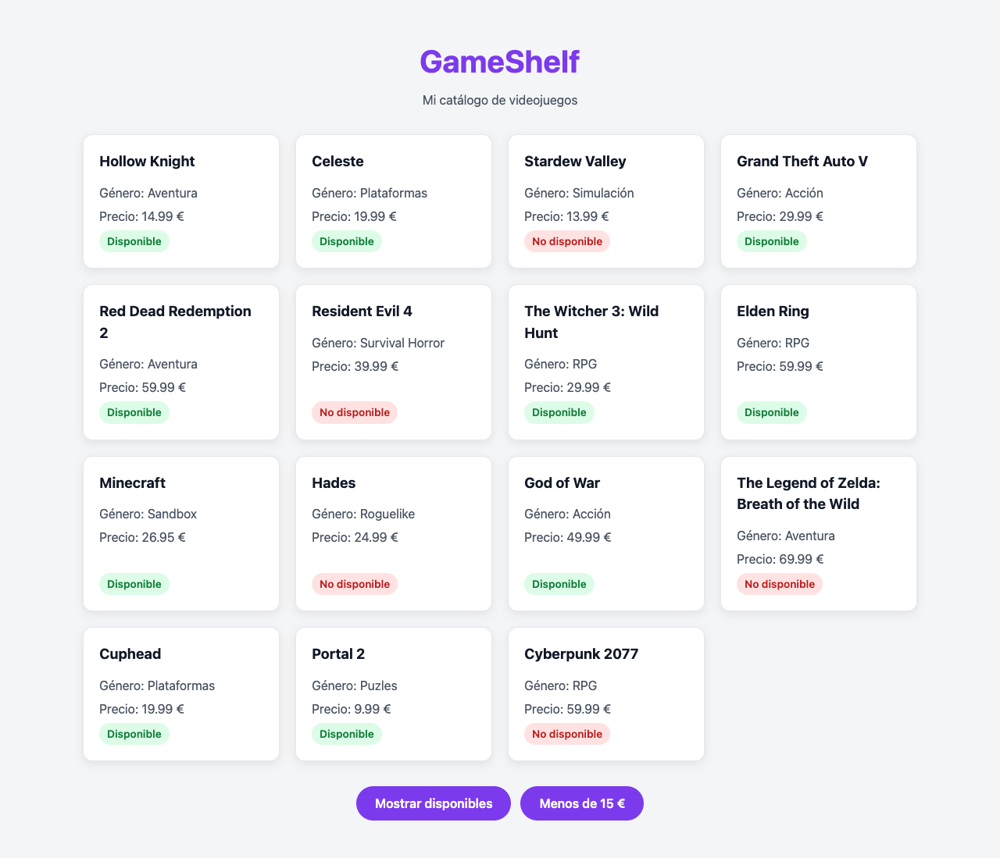
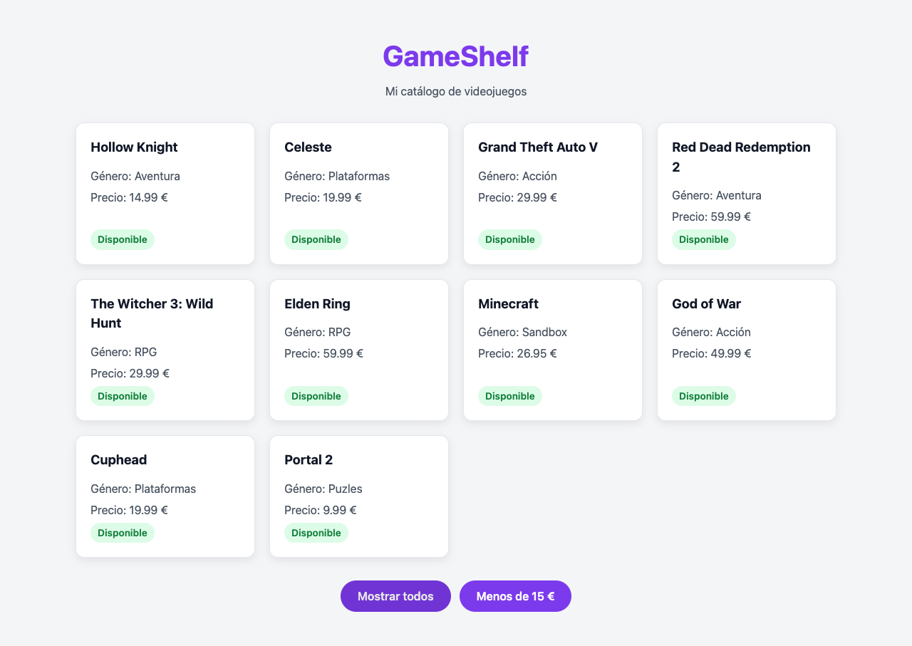
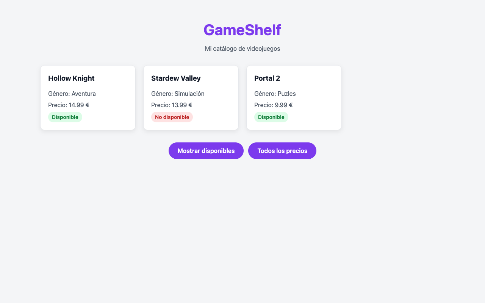
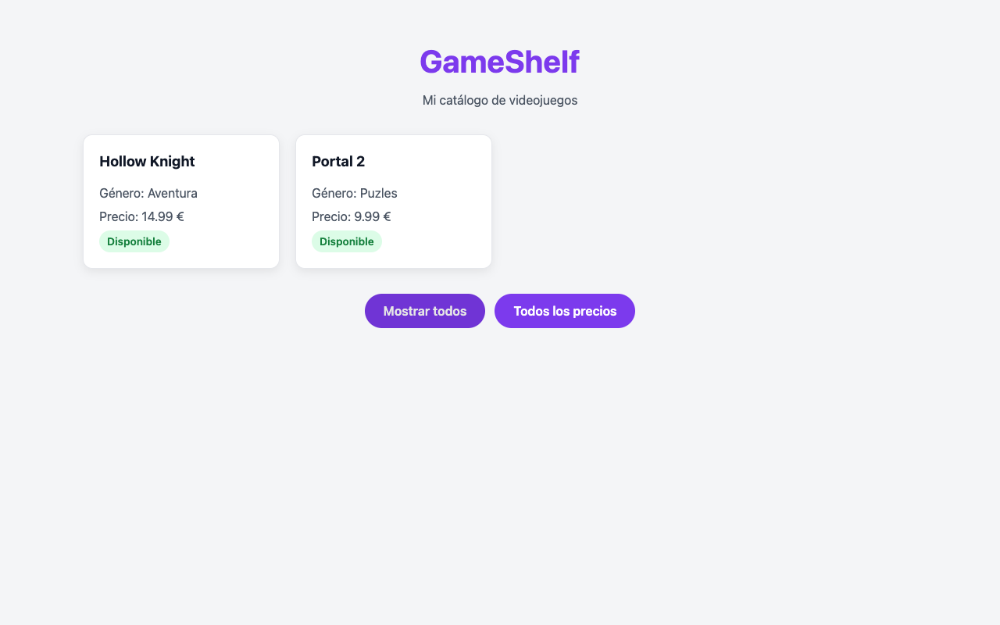

# GameShelf

**Autor:** Carlos Marrero Martin

GameShelf es una página web hecha con React donde muestro un catálogo de 15 videojuegos en tarjetas. En cada tarjeta sale el nombre del juego, el género, el precio y si está disponible o no. Abajo hay dos botones para filtrar: uno para ver solo los juegos disponibles y otro para ver los que cuestan menos de 15 €. Se pueden usar los dos a la vez.

## Cómo ejecutar el proyecto

```bash
npm install
npm run dev
```

Después se abre en el navegador la dirección que sale en la terminal (normalmente `http://localhost:5173`).

Herramientas que he usado: VS Code, Node.js, npm, Vite, React, TypeScript y el navegador para ir probando.

## 1. Herramientas: React, Vite, Node.js y npm

### ¿Qué es React?

React es una librería de JavaScript para hacer interfaces. La idea es dividir la página en componentes, que son trozos que se pueden reutilizar (en mi caso `App` y `GameCard`). Cuando cambian los datos, React vuelve a pintar lo que haga falta sin que yo tenga que tocar el HTML a mano.

### create-vite y Vite

`create-vite` es el comando que crea el proyecto con la plantilla que elijas. Solo se usa una vez, al principio. Vite es la herramienta que se usa después mientras programas.

Con `npm run dev` Vite arranca un servidor local y cada vez que guardo un archivo la página se actualiza sola. Creo que `npm run build` sirve para preparar la versión final: primero comprueba los tipos con `tsc` y luego genera una carpeta `dist` con los archivos optimizados para subirlos a un servidor.

### Node.js y npm

Node.js permite ejecutar JavaScript fuera del navegador. Lo necesitamos porque Vite y npm funcionan con Node. npm es el gestor de paquetes que viene con Node.

- `npm create vite@latest`: crea el proyecto nuevo.
- `npm install`: descarga todas las dependencias que hay en el `package.json`.
- `npm run dev`: ejecuta el script `dev`, que arranca Vite.

### Dependencias y node_modules

Las dependencias son librerías hechas por otros que usa el proyecto, como `react` o `react-dom`. En el `package.json` están separadas en `dependencies` (lo que necesita la app para funcionar) y `devDependencies` (lo que solo se usa para desarrollar, como `vite`, `typescript` o `eslint`).

`node_modules` es la carpeta donde se descargan todas. Pesa muchísimo y no se sube a GitHub porque está en el `.gitignore`. Si alguien descarga el proyecto, con hacer `npm install` se vuelve a crear.

### TypeScript

TypeScript es JavaScript pero con tipos. Puedes decir qué tipo tiene cada dato (`string`, `number`, `boolean`...) y el editor te avisa del error antes de ejecutar.

### JSX y TSX

JSX es una forma de escribir algo parecido a HTML dentro de JavaScript, y es lo que devuelven los componentes. No es HTML de verdad: se usa `className` en vez de `class` y se puede meter JavaScript entre llaves `{}`. TSX es lo mismo pero en archivos de TypeScript, por eso mis archivos son `.tsx`.

## 2. Estructura del proyecto



| Archivo/carpeta | Qué observé | Función |
| --- | --- | --- |
| index.html | Casi vacío, tiene un `div` con `id="root"` y un script que carga `/src/main.tsx` | Es el HTML de entrada de la página |
| src/main.tsx | Importa `App` y `index.css` y usa `createRoot` | Busca el `div` root y mete `App` dentro |
| src/App.tsx | Tiene el array de juegos, los `useState`, los filtros y los botones | Componente principal |
| src/App.css | Reglas `.app`, `.catalog`, `.actions` y `.btn` | Estilos de la página principal |
| src/index.css | Variables de colores en `:root` y el modo oscuro | Estilos globales para toda la app |
| package.json | Nombre del proyecto, scripts (`dev`, `build`, `lint`, `preview`) y dependencias | Configuración del proyecto para npm |
| tsconfig.json | Solo apunta a `tsconfig.app.json` y `tsconfig.node.json` | Configuración de TypeScript |
| vite.config.ts | Muy corto, solo añade el plugin de React | Configuración de Vite |
| public/ y src/assets/ | Iconos e imágenes (`favicon.svg`, `react.svg`, `hero.png`) | Lo de `public` se usa tal cual; lo de `assets` se importa desde el código |
| node_modules/ | Carpeta enorme con miles de archivos | Aquí se instalan las dependencias |
| .gitignore | Lista `node_modules`, `dist`, logs... | Lo que Git no tiene que subir |

- ¿Qué archivo contiene el punto de entrada HTML? `index.html`.
- ¿Qué archivo carga App? `src/main.tsx`.
- ¿Cuál es el componente principal? `App`, que está en `src/App.tsx`.
- ¿Qué hace el script dev? Ejecuta `vite`, que arranca el servidor de desarrollo.
- ¿Qué significa la extensión .tsx? Que es un archivo de TypeScript que lleva JSX dentro.

## 3. Primera pantalla y componentes

Un componente es una función que devuelve JSX, o sea, un trozo de la interfaz. Su nombre tiene que empezar por mayúscula. Al principio la página solo mostraba el título "GameShelf" y el párrafo "Mi catálogo de videojuegos", que salían del componente `App`.

### GameCard y props

`GameCard` es el componente que pinta la tarjeta de un juego. Las props son los datos que le paso desde `App`, como si fueran atributos de HTML:

```tsx
<GameCard title="Celeste" genre="Plataformas" price={19.99} available={true} />
```

Dentro de `GameCard` recojo `title`, `genre`, `price` y `available` y los uso en el JSX. Así tengo un solo componente para todas las tarjetas y lo único que cambia son los datos. Con `available` decido si pone "Disponible" o "No disponible" y qué clase CSS lleva.

## 4. Catálogo de videojuegos

### Funciones, parámetros y funciones flecha

Una función es un bloque de código que hace una tarea y que puedo usar las veces que quiera. Definirla es escribirla (`function App() { ... }`) y llamarla es ejecutarla. Si solo la defino no pasa nada hasta que alguien la llama. Los parámetros son los datos que recibe la función. La función flecha es una forma más corta de escribirla, por ejemplo `(game) => game.available`.

En el `map()`, en cada vuelta `game` es un juego del array: primero Hollow Knight, luego Celeste, y así. La función flecha devuelve un `<GameCard>` con los datos de ese juego. Como uso paréntesis y no llaves, no hace falta poner `return`.

### map() y key

`map()` recorre un array y devuelve otro array nuevo con lo que devuelva la función en cada elemento. Aquí convierte el array `games` (objetos) en una lista de `<GameCard>`, que React pinta en la página.

`key` es un identificador único para cada elemento de la lista. React lo usa para saber qué tarjeta es cuál cuando la lista cambia, por ejemplo al filtrar. Uso `game.id` porque no se repite. Si no lo pones, sale un aviso en la consola.

### Ampliación del catálogo

Elegí 15 juegos que conozco o he jugado, de géneros distintos (RPG, aventura, plataformas, puzles...). Los precios los puse más o menos como están en tiendas como Steam. La disponibilidad la puse a mano mezclando `true` y `false` para poder probar el filtro, y me aseguré de que hubiera algunos de menos de 15 € para el reto (Hollow Knight, Stardew Valley y Portal 2).



## 5. Estilos CSS

CSS es el lenguaje que se usa para darle estilo a la página: colores, tamaños, márgenes, cómo se colocan las cosas... Un selector dice a qué elementos se aplica la regla (por ejemplo `.card` se aplica a todo lo que tenga `className="card"`). Una propiedad es lo que quiero cambiar, como `color`, `padding` o `border-radius`, con su valor.

Reglas que he hecho:

- `index.css`: las variables de colores en `:root` (`--accent`, `--surface`...) y un modo oscuro con `prefers-color-scheme` que solo cambia el valor de esas variables. También el `box-sizing` y quitar el margen del `body`.
- `App.css`: `.app` centra todo con un ancho máximo, `.catalog` es una rejilla con `grid` que pone tantas columnas como quepan, `.actions` pone los botones en fila con `flex` y `.btn` es el estilo de los botones (con `hover` y `active`).
- `GameCard.css`: `.card` para la tarjeta (borde, sombra y que suba un poco al pasar el ratón) y `.available` / `.unavailable` para la etiqueta verde o roja.

Para conectar el TSX con el CSS pongo `className="card"` en el componente y en el CSS hago la regla `.card { ... }`. Los nombres tienen que ser iguales y además hay que importar el CSS en el componente (`import "./GameCard.css"`). En la etiqueta de estado la clase cambia según el juego: `available ? "status available" : "status unavailable"`.

## 6. Filtro de disponibilidad

### Eventos, manejadores y onClick

Un evento es algo que pasa en la página, como hacer clic en un botón. El manejador es la función que se ejecuta cuando pasa ese evento, y con `onClick` se la paso al botón.

Hay que pasarle la función, no llamarla. Si pongo `onClick={setOnlyAvailable(!onlyAvailable)}` se ejecuta nada más pintar el botón, eso cambia el estado, se vuelve a pintar y se queda en bucle (React da el error "Too many re-renders"). Con la flecha le paso una función que solo se ejecuta cuando hago clic.

En `() => setOnlyAvailable(!onlyAvailable)`:

- `() =>` es una función flecha sin parámetros, que es lo que recibe `onClick`.
- `setOnlyAvailable` es la función que cambia el estado.
- `!onlyAvailable` es lo contrario del valor actual: si era `false` pasa a `true` y al revés.

### Estado frente a variable normal

Si uso una variable normal (`let onlyAvailable = false`) y la cambio, el valor cambia pero React no se entera y la pantalla no se actualiza. Además, cada vez que el componente se vuelve a ejecutar, la variable vuelve a empezar en `false`. El estado con `useState` React lo guarda entre renderizados, y cuando lo cambio con su función `set` vuelve a pintar el componente con el valor nuevo.



## 7. Reto: juegos por menos de 15 €

Hice otro estado, `onlyCheap`, igual que el de disponibilidad y con su propio botón. Para que los dos filtros funcionen juntos empiezo con `visibleGames = games` (todos los juegos) y después aplico los filtros uno detrás de otro:

```tsx
let visibleGames = games;

if (onlyAvailable) {
  visibleGames = visibleGames.filter((game) => game.available);
}

if (onlyCheap) {
  visibleGames = visibleGames.filter((game) => game.price < 15);
}
```

Como el segundo `filter` se hace sobre lo que dejó el primero, si están los dos activos solo salen los juegos que cumplen las dos cosas. Luego el `map()` lo hago sobre `visibleGames` en vez de sobre `games`.

Sobre `useState`: en `const [onlyCheap, setOnlyCheap] = useState(false)`, el `false` es el valor inicial. Devuelve dos cosas: `onlyCheap`, que es el valor actual, y `setOnlyCheap`, que es la función para cambiarlo. Cuando llamo a `setOnlyCheap`, React guarda el valor nuevo y vuelve a ejecutar `App`, así que `visibleGames` se calcula otra vez y salen las tarjetas que tocan. El texto del botón también cambia con un ternario.

### Pruebas

- Sin filtros salen los 15 juegos.
- Con "Mostrar disponibles" salen 10, porque se quitan los 5 que tienen `available: false`.
- Con "Menos de 15 €" salen 3: Hollow Knight, Stardew Valley y Portal 2.
- Con los dos a la vez salen 2: Hollow Knight y Portal 2. Stardew Valley es barato pero no está disponible.
- Si vuelvo a pulsar un botón, ese filtro se quita.





## 8. Glosario

| Concepto | Definición propia | Fuente |
| --- | --- | --- |
| JavaScript | Lenguaje de programación que se usa sobre todo para darle funcionalidad a las páginas web | [MDN](https://developer.mozilla.org/es/docs/Web/JavaScript) |
| TypeScript | JavaScript con tipos, para detectar errores antes de ejecutar | [typescriptlang.org](https://www.typescriptlang.org/) |
| JSX | Forma de escribir algo parecido a HTML dentro de JavaScript | [react.dev](https://react.dev/learn/writing-markup-with-jsx) |
| TSX | JSX dentro de un archivo TypeScript | Apuntes de clase |
| Componente | Función que devuelve un trozo de interfaz y que se puede reutilizar | [react.dev](https://react.dev/learn/your-first-component) |
| Props | Datos que un componente padre le pasa a un componente hijo | [react.dev](https://react.dev/learn/passing-props-to-a-component) |
| Función | Bloque de código con una tarea que se puede ejecutar cuando quieras | [MDN](https://developer.mozilla.org/es/docs/Web/JavaScript/Guide/Functions) |
| Parámetro | Dato que recibe una función para trabajar con él | [MDN](https://developer.mozilla.org/es/docs/Web/JavaScript/Guide/Functions) |
| Evento | Algo que pasa en la página, como un clic o escribir en un input | [react.dev](https://react.dev/learn/responding-to-events) |
| Manejador | Función que se ejecuta cuando ocurre un evento | [react.dev](https://react.dev/learn/responding-to-events) |
| Estado | Datos que React recuerda entre renderizados y que al cambiar actualizan la pantalla | [react.dev](https://react.dev/learn/state-a-components-memory) |
| Callback | Función que se pasa a otra función para que la ejecute ella (como la flecha de `map` o de `onClick`) | [MDN](https://developer.mozilla.org/es/docs/Glossary/Callback_function) |
| filter() | Método de los arrays que devuelve un array nuevo solo con los elementos que cumplen una condición | [MDN](https://developer.mozilla.org/es/docs/Web/JavaScript/Reference/Global_Objects/Array/filter) |

## 9. Dificultades

Lo que más me costó fue combinar los dos filtros. Al principio hacía cada `filter` sobre `games` directamente y un filtro pisaba al otro, así que nunca funcionaban los dos juntos. Lo arreglé guardando el resultado en `visibleGames` y aplicando el segundo filtro sobre lo que dejó el primero. También al principio se me olvidó poner `key` en el `map()` y salía un aviso en la consola.

## 10. Reflexión final

1. ¿Qué archivo conecta el HTML con App? `src/main.tsx`. Busca el `div` con `id="root"` del `index.html` y pinta `App` dentro.
2. ¿Qué diferencias hay entre React, TypeScript y Vite? React es la librería con la que hago la interfaz con componentes. TypeScript es el lenguaje (JavaScript con tipos). Vite es la herramienta que arranca el servidor de desarrollo y prepara el proyecto final.
3. ¿Qué son las props de GameCard? Los datos que le paso desde `App`: `title`, `genre`, `price` y `available`.
4. ¿Por qué usamos setOnlyAvailable para cambiar el estado? Porque si cambio el valor directamente React no se entera. Con `setOnlyAvailable` React guarda el valor nuevo y vuelve a pintar el componente.
5. ¿Qué hacen map() y filter()? `map()` transforma cada elemento de un array en otra cosa (aquí cada juego en un `GameCard`). `filter()` se queda solo con los elementos que cumplen una condición. Los dos devuelven un array nuevo sin cambiar el original.
6. ¿Para qué sirve key? Para que React sepa qué elemento de la lista es cada uno y pueda actualizarla bien cuando cambia.
7. ¿Qué error te costó más resolver y cómo lo solucionaste? Que los dos filtros no funcionaban a la vez. Lo solucioné aplicando los filtros uno detrás de otro sobre `visibleGames`.

## Fuentes consultadas

- [Guía de inicio de Vite](https://vite.dev/guide/)
- [Aprender React](https://react.dev/learn)
- [Primer componente de React](https://react.dev/learn/your-first-component)
- [Estado de un componente](https://react.dev/learn/state-a-components-memory)
- [Mostrar listas en React](https://react.dev/learn/rendering-lists)

## Repositorio

[https://github.com/CarlosMarreroM/pgl-2dam/tree/main/ut1-fundamentos/gameshelf](https://github.com/CarlosMarreroM/pgl-2dam/tree/main/ut1-fundamentos/gameshelf)
